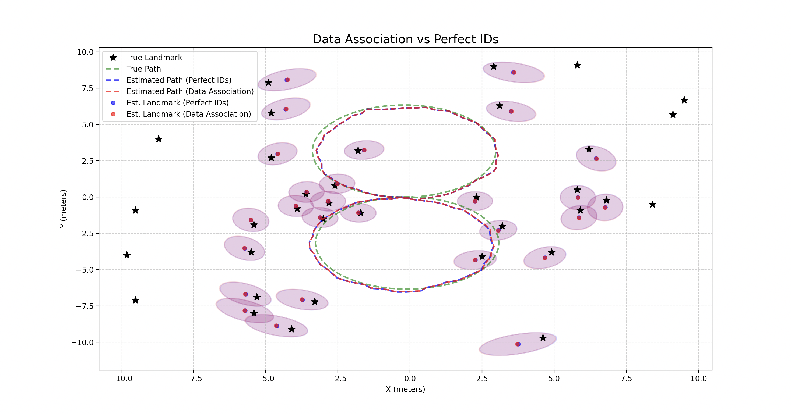
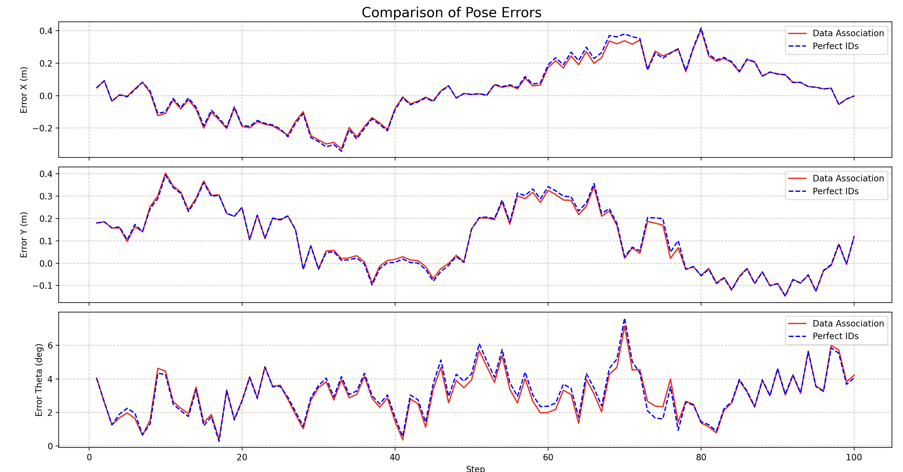

# SLAM with Unscented Kallman Filter (UKF)

This project implements a Simultaneous Localization and Mapping (SLAM) algorithm using the Unscented Kalman Filter (UKF) for a mobile robot with differential drive kinematics (Differential Drive). The main objective is to jointly estimate the robot's pose and the map of the environment's features (landmarks) starting from an unknown environment. The system compares the filter's performance in two main configurations: assuming the landmark identities are perfectly known a priori (Perfect IDs) and using a realistic Data Association system based on the Mahalanobis distance.

## Project Structure
The repository is organized into the following main files and directories:
- `Main.py`: The startup script that handles the simulation, landmark generation, robot movements, and execution of the UKF filters (with and without Data Association). It also allows for configuring various scenarios and plotting graphs (static or real-time) to analyze pose and landmark errors.

- `UKF_SLAM_CLASSES.py`: Contains the logical implementations of the filters. It defines the base class `UKF_SLAM` for mathematical prediction and update operations (Predict and Update with known IDs), and the subclass `UKF_SLAM_DA` for the implementation of the autonomous data association logic.

- `DifferentialDrive.py`: Defines the kinematic model used for propagating the mobile robot's state (`f`) and the geometric model of the range-bearing sensor (`g`) used for observations.

- `utils/angle.py`: A utility module containing the `normalize_angle` function, which normalizes angular values to keep them strictly within the $[-\pi, \pi]$ range during state updates and error calculations.

- `UKF_SLAM_Report.pdf` and `UKF_SLAM.pdf`: Detailed academic documentation and presentation slides of the project.

## Simulation Scenarios

The Data Association algorithm is evaluated under three conditions of increasing complexity, configurable via the `SIMULATION_CASE` variable in `Main.py`:
- **Best Case**: Optimal conditions characterized by a high density of features and low measurement noise.

- **Middle Case**: Realistic scenario with moderate density and increased kinematic noise levels.

- **Worst Case**: Highly sparse environment and severe kinematic noise.

## Algorithmic Features
- `Unscented Transform (UT)`: Unlike the Extended Kalman Filter (EKF), the propagation of uncertainty and the mean through non-linear functions occurs by generating deterministic points (**sigma points**), eliminating the need to calculate Jacobian matrices.

- `Gating with Mahalanobis Distance`: Every new observation from the sensors is analyzed by measuring the Mahalanobis distance ($D^2$) against previously mapped landmarks. If the minimum value of $D^2$ exceeds the limit set by the validation gate ($\gamma = 5.991$, which represents the 95% confidence region for a chi-squared distribution with 2 degrees of freedom), the association is rejecte.

- `Dynamic Map Augmentation`: Observations that fail to associate with existing landmarks are treated as newly discovered entities; the algorithm initializes their coordinates and dynamically expands the dimensions of the state vector and the covariance matrix.

## Configuration, Execution & Dependencies
The project was developed in Python. To run the simulation, the external mathematical and plotting libraries are required.

```bash
pip install numpy scipy matplotlib
```

The main parameters for starting the simulation can be customized directly in the global constants section of the `Main.py` file:

- `SIMULATION_CASE = "best" | "middle" | "worst"` defines the environment's complexity level.

- `MODE_COMPARISON = True` launches the simulation side-by-side in split-screen to visually and mathematically compare the performance of the system with known IDs (Perfect IDs) against the one that deduces associations autonomously (Data Association).

- `ENABLE_REALTIME = True` enables live graphical visualization of the covariance evolution, position estimation, and the addition of new landmarks.